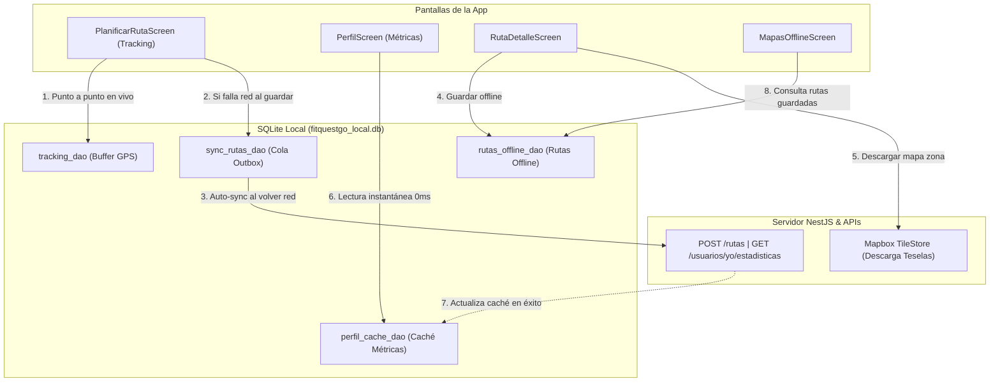

# Informe de Implementación: Persistencia Local con SQLite, Soporte Offline y Product Backlog

**Proyecto:** FitQuest Go (Aplicación Móvil Flutter)  
**Fecha:** 19 de Octubre de 2026  
**Contexto:** Soporte de resiliencia ante pérdida de conexión y cierre inesperado en actividades al aire libre (senderismo / running).

---

## 1. Resumen de Cambios Implementados en la Aplicación

Antes de esta sesión, FitQuest Go dependía al 100% de la conectividad con el Backend para todas sus operaciones, careciendo de base de datos local (solo almacenaba tokens JWT). Ante pérdidas de señal en montaña o cierres de la app por memoria, los datos de ruta en grabación se perdían.

Se diseñó e integró una arquitectura híbrida donde el **Backend (PostgreSQL/NestJS)** se mantiene como la **fuente de la verdad** global, mientras que **SQLite (vía `sqflite`)** asume el rol de **motor de resiliencia y soporte offline**.

### Componentes nuevos implementados:

1. **Capa de Base de Datos Local ([app_database.dart](file:///c:/Users/Joseth/Desktop/FitQuest%20Go/AppFitQuestGo/lib/core/db/app_database.dart)):**
   - Singleton seguro con ciclo de vida de conexión SQLite y degradación silenciosa en entornos de test donde no existe motor SQLite nativo.
   - Creación de 5 tablas relacionales: `sesion_tracking_temp`, `puntos_tracking_temp`, `rutas_pendientes_sync`, `rutas_offline` y `perfil_cache`.
   - Método `limpiarDatosUsuario()` para vaciar las tablas locales al cerrar sesión.

2. **Buffer de Grabación GPS y Recuperación de Sesión ([tracking_dao.dart](file:///c:/Users/Joseth/Desktop/FitQuest%20Go/AppFitQuestGo/lib/core/db/daos/tracking_dao.dart) y [planificar_ruta_screen.dart](file:///c:/Users/Joseth/Desktop/FitQuest%20Go/AppFitQuestGo/lib/Modulos/rutas/presentation/planificar_ruta_screen.dart)):**
   - Cada punto de GPS capturado se guarda asíncronamente en SQLite junto con el tiempo transcurrido y la distancia acumulada.
   - Si la aplicación es cerrada por falta de memoria o batería, al volver a abrir la pantalla se detecta la sesión interrumpida y se despliega un diálogo con 3 opciones: **Reanudar**, **Guardar lo grabado** o **Descartar**.
   - Extensión de [cronometro_ruta.dart](file:///c:/Users/Joseth/Desktop/FitQuest%20Go/AppFitQuestGo/lib/Modulos/rutas/application/cronometro_ruta.dart) para soportar inicio con tiempo acumulado previo.

3. **Cola de Sincronización Diferida / Outbox Pattern ([sync_rutas_dao.dart](file:///c:/Users/Joseth/Desktop/FitQuest%20Go/AppFitQuestGo/lib/core/db/daos/sync_rutas_dao.dart), [sync_rutas_service.dart](file:///c:/Users/Joseth/Desktop/FitQuest%20Go/AppFitQuestGo/lib/Modulos/rutas/application/sync_rutas_service.dart) y [rutas_pendientes_banner.dart](file:///c:/Users/Joseth/Desktop/FitQuest%20Go/AppFitQuestGo/lib/Modulos/rutas/presentation/widgets/rutas_pendientes_banner.dart)):**
   - Al guardar una ruta, si `_api.crear()` falla por desconexión (`SocketException` o timeout), la ruta se almacena automáticamente en SQLite con estado pendiente.
   - El servicio `SyncRutasService` escucha la conectividad mediante `connectivity_plus` y reintenta subir las rutas en segundo plano al recuperar red o al iniciar la aplicación ([user_shell.dart](file:///c:/Users/Joseth/Desktop/FitQuest%20Go/AppFitQuestGo/lib/Modulos/home/presentation/user_shell.dart)).
   - En la pantalla de Perfil ([perfil_screen.dart](file:///c:/Users/Joseth/Desktop/FitQuest%20Go/AppFitQuestGo/lib/Modulos/perfil/presentation/perfil_screen.dart)), se muestra un banner informativo con el conteo de rutas pendientes y un botón para forzar la sincronización manual.

4. **Caché Offline-First del Perfil ([perfil_cache_dao.dart](file:///c:/Users/Joseth/Desktop/FitQuest%20Go/AppFitQuestGo/lib/core/db/daos/perfil_cache_dao.dart)):**
   - La cabecera de estadísticas (KM, Rutas e Insignias) lee inmediatamente los últimos valores almacenados en SQLite, eliminando el parpadeo de carga (`—`).
   - En paralelo solicita `/usuarios/yo/estadisticas` al backend y actualiza la base local cuando la respuesta llega con éxito.

5. **Mapas y Rutas Offline con Mapbox ([rutas_offline_dao.dart](file:///c:/Users/Joseth/Desktop/FitQuest%20Go/AppFitQuestGo/lib/core/db/daos/rutas_offline_dao.dart), [mapas_offline_servicio.dart](file:///c:/Users/Joseth/Desktop/FitQuest%20Go/AppFitQuestGo/lib/core/mapa/mapas_offline_servicio.dart) y [mapas_offline_screen.dart](file:///c:/Users/Joseth/Desktop/FitQuest%20Go/AppFitQuestGo/lib/Modulos/perfil/presentation/mapas_offline_screen.dart)):**
   - Botón *"Guardar para uso offline"* en [ruta_detalle_screen.dart](file:///c:/Users/Joseth/Desktop/FitQuest%20Go/AppFitQuestGo/lib/Modulos/rutas/presentation/ruta_detalle_screen.dart), con barra de progreso interactiva.
   - Almacenamiento de puntos y metadatos en SQLite y descarga del polígono de teselas mediante `TileStore.createDefault()` de Mapbox.
   - Pantalla dedicada en Perfil que lista las rutas descargadas con opción de abrirlas sin red o eliminarlas liberando espacio.

6. **Protección de Costos y Recursos Mapbox:**
   - Restricción a máximo **3 rutas offline simultáneas**.
   - Zoom acotado de **12 a 14** (reducción del 85% de descarga respecto al zoom 16).
   - Margen perimetral ajustado a ~500 metros sobre el sendero.

7. **Cierre de Sesión Seguro ([auth_repositorio.dart](file:///c:/Users/Joseth/Desktop/FitQuest%20Go/AppFitQuestGo/lib/Modulos/auth/data/auth_repositorio.dart)):**
   - Vaciado de todas las tablas SQLite al cerrar sesión para garantizar que otro usuario en el mismo dispositivo no acceda a información previa.

---

### Resumen de Archivos Tocados

| Archivo | Tipo | Propósito |
|---|---|---|
| [`pubspec.yaml`](file:///c:/Users/Joseth/Desktop/FitQuest%20Go/AppFitQuestGo/pubspec.yaml) | Modificado | Inclusión de `sqflite`, `path` y `connectivity_plus`. |
| [`lib/core/db/app_database.dart`](file:///c:/Users/Joseth/Desktop/FitQuest%20Go/AppFitQuestGo/lib/core/db/app_database.dart) | **Nuevo** | Conexión, DDL de tablas y limpieza de sesión. |
| [`lib/core/db/daos/tracking_dao.dart`](file:///c:/Users/Joseth/Desktop/FitQuest%20Go/AppFitQuestGo/lib/core/db/daos/tracking_dao.dart) | **Nuevo** | Almacenamiento temporal de puntos GPS en vivo. |
| [`lib/core/db/daos/sync_rutas_dao.dart`](file:///c:/Users/Joseth/Desktop/FitQuest%20Go/AppFitQuestGo/lib/core/db/daos/sync_rutas_dao.dart) | **Nuevo** | Cola local outbox para rutas terminadas offline. |
| [`lib/core/db/daos/rutas_offline_dao.dart`](file:///c:/Users/Joseth/Desktop/FitQuest%20Go/AppFitQuestGo/lib/core/db/daos/rutas_offline_dao.dart) | **Nuevo** | CRUD de rutas guardadas para uso offline. |
| [`lib/core/db/daos/perfil_cache_dao.dart`](file:///c:/Users/Joseth/Desktop/FitQuest%20Go/AppFitQuestGo/lib/core/db/daos/perfil_cache_dao.dart) | **Nuevo** | Caché de estadísticas de usuario. |
| [`lib/core/mapa/mapas_offline_servicio.dart`](file:///c:/Users/Joseth/Desktop/FitQuest%20Go/AppFitQuestGo/lib/core/mapa/mapas_offline_servicio.dart) | **Nuevo** | Gestor de descarga de teselas con Mapbox TileStore. |
| [`lib/Modulos/rutas/application/sync_rutas_service.dart`](file:///c:/Users/Joseth/Desktop/FitQuest%20Go/AppFitQuestGo/lib/Modulos/rutas/application/sync_rutas_service.dart) | **Nuevo** | Servicio background para subir rutas pendientes. |
| [`lib/Modulos/rutas/presentation/widgets/rutas_pendientes_banner.dart`](file:///c:/Users/Joseth/Desktop/FitQuest%20Go/AppFitQuestGo/lib/Modulos/rutas/presentation/widgets/rutas_pendientes_banner.dart) | **Nuevo** | Banner visual con botón de sincronización. |
| [`lib/Modulos/perfil/presentation/mapas_offline_screen.dart`](file:///c:/Users/Joseth/Desktop/FitQuest%20Go/AppFitQuestGo/lib/Modulos/perfil/presentation/mapas_offline_screen.dart) | **Nuevo** | Vista de consulta y gestión de rutas offline. |
| [`lib/Modulos/rutas/application/cronometro_ruta.dart`](file:///c:/Users/Joseth/Desktop/FitQuest%20Go/AppFitQuestGo/lib/Modulos/rutas/application/cronometro_ruta.dart) | Modificado | Soporte de inicio con duración acumulada previa. |
| [`lib/Modulos/rutas/presentation/planificar_ruta_screen.dart`](file:///c:/Users/Joseth/Desktop/FitQuest%20Go/AppFitQuestGo/lib/Modulos/rutas/presentation/planificar_ruta_screen.dart) | Modificado | Guardado punto a punto en buffer, diálogo de crash recovery y guardado en cola outbox. |
| [`lib/Modulos/rutas/presentation/ruta_detalle_screen.dart`](file:///c:/Users/Joseth/Desktop/FitQuest%20Go/AppFitQuestGo/lib/Modulos/rutas/presentation/ruta_detalle_screen.dart) | Modificado | Botón para descargar ruta y mapa con tope de 3 rutas. |
| [`lib/Modulos/perfil/presentation/perfil_screen.dart`](file:///c:/Users/Joseth/Desktop/FitQuest%20Go/AppFitQuestGo/lib/Modulos/perfil/presentation/perfil_screen.dart) | Modificado | Banner de rutas pendientes, métricas desde caché y navegación a Mapas Offline. |
| [`lib/Modulos/home/presentation/user_shell.dart`](file:///c:/Users/Joseth/Desktop/FitQuest%20Go/AppFitQuestGo/lib/Modulos/home/presentation/user_shell.dart) | Modificado | Disparo de sincronización automática al abrir la aplicación. |
| [`lib/Modulos/auth/data/auth_repositorio.dart`](file:///c:/Users/Joseth/Desktop/FitQuest%20Go/AppFitQuestGo/lib/Modulos/auth/data/auth_repositorio.dart) | Modificado | Limpieza de base de datos local al invocar `cerrarSesion()`. |

---

## 2. Aspectos Clave y Consideraciones que Debes Saber

1. **Reinicio Completo Obligatorio:**
   * Dado que se agregaron librerías con código nativo Android/C++ (`sqflite`, `connectivity_plus`), **no basta con un Hot Reload**. Debes detener el proceso y ejecutar `flutter run` para que Gradle recompile las dependencias nativas en el APK.
2. **Cero Costos en Mapbox Garantizados:**
   * El plan gratuito de Mapbox ofrece 25.000 usuarios activos mensuales y decenas de miles de peticiones.
   * Con el límite de **3 rutas offline** y **zoom 12-14**, el consumo es residual (unos pocos KB/MB por ruta). Si no tienes tarjeta registrada en Mapbox, es imposible que te facturen.
3. **Comportamiento en Tests Automatizados:**
   * Los tests unitarios (`flutter test`) corren en el host (Windows) sin el motor SQLite del sistema operativo móvil. `AppDatabase` fue diseñado para retornar `null` en ese entorno de manera transparente, permitiendo que la suite completa (662 tests) pase sin errores ni mocks intrusivos.
4. **Seguimiento GPS:**
   * La grabación GPS sigue funcionando únicamente en **primer plano** (con la pantalla encendida y la app activa). La implementación en segundo plano (Foreground Service) corresponde a un hito futuro según el diseño original.

---

## 3. Guía de Pruebas Manuales Paso a Paso

Para comprobar en tu teléfono o emulador que todas las características funcionan:

### Prueba 1: Guardado de Ruta Offline (Outbox Pattern)
1. Inicia sesión en la aplicación.
2. Abre la pestaña **Planificar** (icono de ruta en la barra de navegación).
3. Activa el **Modo Avión** en tu dispositivo.
4. Dibuja o graba una ruta de al menos 2 puntos y pulsa **Guardar**.
5. Llena el formulario con un nombre (ej. *"Ruta Sin Red"*) y confirma.
6. **Resultado esperado:** La app no muestra error de red. Muestra un mensaje informativo indicando que la ruta se guardó en el dispositivo y se subirá al recuperar la conexión.

### Prueba 2: Sincronización Automática y Banner
1. Ve a la pestaña **Perfil**.
2. **Resultado esperado:** En la parte superior aparece el banner amarillo: *"Tienes 1 ruta pendiente de subir"* con el botón *Sincronizar*.
3. Desactiva el **Modo Avión** (conecta a WiFi o datos móviles).
4. **Resultado esperado:** El banner detecta automáticamente la conexión, sube la ruta al backend, muestra la notificación de éxito *"Ruta pendiente subida"* y desaparece. Los kilómetros y rutas completadas se actualizan.

### Prueba 3: Simulación de Cierre Inesperado / Crash en Tracking
1. En la pestaña **Planificar**, selecciona el modo **Grabar GPS** y pulsa **Iniciar grabación**.
2. Camina unos metros (o simula coordenadas en el emulador con `geo fix`) para acumular al menos 3 o 4 puntos en pantalla.
3. **Fuerza el cierre de la app** desde el selector de apps recientes de Android (desliza hacia arriba para matarla) o mediante `adb shell am force-stop <package>`.
4. Abre nuevamente la app y ve a la pestaña **Planificar**.
5. **Resultado esperado:** Se abre de inmediato un diálogo: *"Grabación interrumpida: Se detectó una ruta sin terminar de X km (N puntos). ¿Qué quieres hacer?"*.
6. Prueba tocar **Reanudar**: el cronómetro retoma desde los segundos acumulados y los puntos se redibujan en el mapa.

### Prueba 4: Descarga de Rutas y Mapas Offline
1. Con conexión a internet activa, ve a **Rutas** y abre el detalle de cualquier ruta existente.
2. Pulsa el botón **"Guardar para uso offline"**.
3. **Resultado esperado:** El botón pasa a estado de carga mostrando el porcentaje de descarga de teselas (*"Descargando... X%"*). Al finalizar, cambia a *"Disponible offline · Quitar"*.
4. Activa el **Modo Avión**.
5. Ve a **Perfil > Mapas offline**.
6. **Resultado esperado:** La ruta aparece en la lista con su kilometraje y número de puntos. Al tocarla, se abre su vista detallada mostrando el mapa con el trazo visible aun estando sin internet.

### Prueba 5: Tope de Seguridad de Rutas Offline
1. Descarga 3 rutas distintas para uso offline.
2. Intenta presionar "Guardar para uso offline" en una 4ª ruta.
3. **Resultado esperado:** La app bloquea la acción y te notifica: *"Límite de 3 rutas offline alcanzado. Elimina una para descargar otra."*.

### Prueba 6: Caché de Métricas de Perfil
1. Con internet, ingresa a **Perfil** para asegurarte de que tus datos de KM e Insignias están cargados.
2. Cierra la app y activa el **Modo Avión**.
3. Vuelve a abrir la app e ingresa a **Perfil**.
4. **Resultado esperado:** Las métricas de KM, Rutas e Insignias se muestran **instantáneamente** con el último valor guardado en SQLite, sin mostrar guiones `—` ni ruedas de carga infinitas.

### Prueba 7: Cierre de Sesión Seguro
1. En **Perfil**, abre los ajustes de la cuenta y pulsa **Cerrar sesión**.
2. Inicia sesión con una cuenta de prueba distinta o vacía.
3. **Resultado esperado:** En *Mapas offline* la lista está vacía y las métricas anteriores no aparecen, demostrando que la base de datos local fue sanitizada.

---

## 4. Aspectos que Quedan Pendientes (Trabajo Futuro)

1. **Ubicación GPS en Segundo Plano:**
   - La grabación actual requiere que la app permanezca en primer plano. Integrar un Foreground Service de Android (`flutter_foreground_task` + permiso `ACCESS_BACKGROUND_LOCATION`) permitirá grabar con la pantalla bloqueada.
2. **Banner de Rutas Pendientes en la Pestaña "Rutas":**
   - Actualmente el aviso visual solo está en la pantalla de Perfil. Se puede reutilizar `RutasPendientesBanner` en la cabecera de `RutasScreen`.
3. **Límite de Reintentos en Errores de Validación (400):**
   - Si el backend rechaza una ruta por datos inválidos (código HTTP 400), la cola la conserva con el error. Conviene añadir una opción para que el usuario pueda descartar o editar manualmente la ruta rechazada.
4. **Internacionalización (l10n):**
   - Las nuevas cadenas de texto se introdujeron directamente en español. Si el proyecto requiere soporte en inglés, deben agregarse a `app_en.arb` y `app_es.arb`.

---

## 5. Product Backlog y Tasks (Metodología Ágil / Scrum)

A continuación se detallan las Historias de Usuario (PBIs) con sus correspondientes Tareas Técnicas (Tasks) listas para documentar en Jira, Trello o en el informe académico del proyecto.

---

### **PBI-01: Resiliencia y Recuperación de Sesión de Tracking GPS en Vivo**
* **ID:** PBI-SQLITE-01
* **Prioridad:** Alta
* **Estimación:** 5 Puntos de Historia
* **Descripción:**  
  *Como* usuario deportista que graba rutas con GPS en zonas remotas,  
  *Quiero* que cada punto de mi recorrido se guarde automáticamente en el almacenamiento local de mi teléfono,  
  *Para* no perder mi entrenamiento si la aplicación se cierra inesperadamente por falta de memoria o si se apaga el teléfono por batería baja.
* **Criterios de Aceptación:**
  1. *Dado* que el usuario inicia una grabación GPS, *cuando* el GPS reporta una nueva posición válida, *entonces* el punto, tiempo transcurrido y distancia acumulada deben persistir en SQLite.
  2. *Dado* que la app se cerró inesperadamente durante una grabación, *cuando* el usuario abre la pantalla de Planificar, *entonces* debe mostrarse un modal informando los kilómetros y puntos rescatados, ofreciendo las opciones "Reanudar", "Guardar lo grabado" y "Descartar".
  3. *Dado* que el usuario selecciona "Reanudar", *entonces* el mapa debe reconstruir la polilínea previa y el cronómetro debe continuar desde los segundos acumulados.
  4. *Dado* que el usuario descarta o guarda exitosamente la ruta, *entonces* la tabla temporal debe quedar vacía.

#### **Tasks Técnicos de PBI-01:**
* **TASK-01.1:** Instalar y configurar `sqflite` y `path` en `pubspec.yaml`, creando la clase base `AppDatabase` con la tabla `puntos_tracking_temp` y `sesion_tracking_temp`.
* **TASK-01.2:** Implementar `TrackingDao` con métodos `iniciarSesion()`, `agregarPunto()`, `recuperar()` y `limpiar()`.
* **TASK-01.3:** Extender `CronometroRuta` en `lib/Modulos/rutas/application/` para permitir su inicialización con un valor acumulado `Duration inicial`.
* **TASK-01.4:** Modificar `PlanificarRutaScreen` para suscribir el flujo de GPS al DAO e implementar la comprobación post-frame callback que levanta el modal de recuperación.

---

### **PBI-02: Almacenamiento y Sincronización Offline de Rutas (Outbox Pattern)**
* **ID:** PBI-SQLITE-02
* **Prioridad:** Alta
* **Estimación:** 8 Puntos de Historia
* **Descripción:**  
  *Como* usuario que finaliza una ruta en una zona rural o montañosa sin señal celular,  
  *Quiero* poder guardar mi ruta localmente en el dispositivo y que se suba automáticamente cuando vuelva a tener conexión,  
  *Para* garantizar que mis rutas completadas se registren en mi cuenta sin depender de cobertura de red inmediata.
* **Criterios de Aceptación:**
  1. *Dado* que el usuario intenta guardar una ruta y la llamada HTTP falla por error de red o timeout, *entonces* los datos deben serializarse y guardarse en la tabla local `rutas_pendientes_sync`.
  2. *Dado* que existen rutas pendientes en SQLite, *cuando* el usuario abre la app o el dispositivo recupera señal de internet, *entonces* un servicio en segundo plano debe enviar las rutas al backend (`POST /rutas`) en orden FIFO.
  3. *Dado* que hay rutas pendientes, *cuando* el usuario visita la pantalla de Perfil, *entonces* debe visualizarse un banner con la cantidad de rutas por subir y un botón para forzar la sincronización manual.
  4. *Dado* que la ruta se sincroniza exitosamente con el backend, *entonces* debe eliminarse de la cola local y emitir una notificación toast al usuario.

#### **Tasks Técnicos de PBI-02:**
* **TASK-02.1:** Diseñar la tabla `rutas_pendientes_sync` en `AppDatabase` con campos para nombre, actividades, dificultad, distancia, coordenadas JSON y estado de sincronización.
* **TASK-02.2:** Crear `SyncRutasDao` con métodos para encolar, consultar pendientes, registrar errores y eliminar registros sincronizados.
* **TASK-02.3:** Implementar `SyncRutasService` con control de concurrencia (`_enCurso`) para iterar la cola y consumir `RutaApi.crear()`.
* **TASK-02.4:** Diseñar el widget `RutasPendientesBanner` con escucha de cambios de conectividad mediante `connectivity_plus`.
* **TASK-02.5:** Integrar la sincronización en el arranque de la aplicación en `UserShell` y la captura de excepciones de red en el formulario de `PlanificarRutaScreen`.

---

### **PBI-03: Caché Offline-First de Métricas y Estadísticas de Perfil**
* **ID:** PBI-SQLITE-03
* **Prioridad:** Media
* **Estimación:** 3 Puntos de Historia
* **Descripción:**  
  *Como* usuario que ingresa a la sección de Perfil,  
  *Quiero* ver de inmediato mis estadísticas acumuladas de kilómetros, rutas completadas e insignias,  
  *Para* tener una experiencia fluida sin pantallas en blanco ni esperas por la respuesta del servidor.
* **Criterios de Aceptación:**
  1. *Dado* que el usuario abre su Perfil, *cuando* la pantalla se renderiza, *entonces* las tarjetas de KM, Rutas e Insignias deben mostrar los últimos valores cacheados en SQLite sin delay (0 ms).
  2. *Dado* que se completa la petición asíncrona a `/usuarios/yo/estadisticas`, *cuando* los datos llegan del backend, *entonces* se actualiza la interfaz reactivamente y se sobrescribe el registro en la tabla `perfil_cache`.
  3. *Dado* que no hay conexión a internet, *entonces* el perfil debe continuar mostrando las estadísticas locales en vez de guiones vacíos (`—`).

#### **Tasks Técnicos de PBI-03:**
* **TASK-03.1:** Crear la tabla `perfil_cache` en `AppDatabase` con clave primaria `id_usuario`.
* **TASK-03.2:** Implementar `PerfilCacheDao` con métodos `guardar()` y `leer()`.
* **TASK-03.3:** Refactorizar el widget `_MetricasEjemplo` en `perfil_screen.dart` para implementar la estrategia "Stale-While-Revalidate" (mostrar caché local y actualizar con backend en paralelo).

---

### **PBI-04: Consulta y Descarga de Rutas y Mapas Offline con Mapbox**
* **ID:** PBI-SQLITE-04
* **Prioridad:** Media
* **Estimación:** 8 Puntos de Historia
* **Descripción:**  
  *Como* explorador de rutas de montaña,  
  *Quiero* descargar previamente las rutas de mi interés con su mapa cartográfico al almacenamiento local,  
  *Para* poder navegar y visualizar el sendero sobre el mapa aun estando en modo avión o en zonas sin ninguna cobertura.
* **Criterios de Aceptación:**
  1. *Dado* que el usuario visualiza el detalle de una ruta, *entonces* debe existir un botón "Guardar para uso offline".
  2. *Dado* que el usuario pulsa "Guardar para uso offline", *entonces* la app debe guardar los metadatos y puntos en SQLite y descargar el paquete de teselas de Mapbox en un rango de zoom optimizado (12 a 14) con un indicador de progreso.
  3. *Dado* que el usuario ya tiene 3 rutas offline guardadas, *cuando* intenta descargar una cuarta, *entonces* el sistema debe bloquear la descarga e indicarle que debe eliminar una ruta para no sobrepasar la cuota.
  4. *Dado* que el usuario ingresa a "Perfil > Mapas offline", *entonces* debe visualizarse la lista de rutas guardadas localmente, con la opción de abrirlas en detalle sin red o eliminarlas liberando espacio.

#### **Tasks Técnicos de PBI-04:**
* **TASK-04.1:** Crear la tabla `rutas_offline` y su correspondiente `RutasOfflineDao` para almacenar trazos y características completas de la ruta.
* **TASK-04.2:** Desarrollar `MapasOfflineServicio` integrando `TileStore.createDefault()` y `TileRegionLoadOptions` con zoom acotado (12-14) y margen reducido (~500m).
* **TASK-04.3:** Modificar `RutaDetalleScreen` incorporando el botón con estados reactivos (Guardar, Descargando con porcentaje, Disponible offline y Quitar) y la validación de tope de 3 rutas.
* **TASK-04.4:** Construir la pantalla `MapasOfflineScreen` conectada al menú de Perfil en sustitución del aviso provisional.
* **TASK-04.5:** Implementar la sanitización de datos locales (`limpiarDatosUsuario`) en `AuthRepositorio.cerrarSesion()`.
